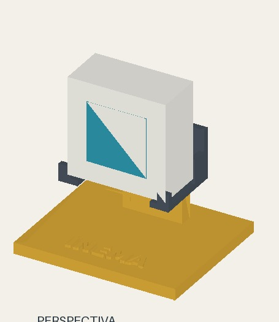

# Robô caixa fixa

**[Português](README.md) · [English](README.en.md) · [Español](README.es.md)**

## What it is

Robô caixa fixa is a 3D-printed mount for anyone who wants to build a desktop robot with less mechanical work. It uses the Waveshare ESP32-S3 module with a 1.54-inch screen, keeping the original case and electronics. Download the two parts, test the cradle first, then print the base with INEMA embossed in the same color. You’ll need a 3D printer, Bambu Studio, filament, the module, and screws. The design was checked on a computer; the physical fit and AI conversation have not yet been validated in this project.

## Guide and downloads

**https://inematds.github.io/robo-caixa-fixa/guia/en/**

The guide includes the STL files, a ZIP package, a 3D assembly, checks, and slicing instructions for the A1. Start with the cradle. The files are for study and have not yet been physically validated; there is no G-code or validated 3MF profile.

## Project files

- [Physical project](PROJETO-FISICO.md) (in Portuguese).
- [Definition and variants](DEFINICAO.md) (in Portuguese).
- [CAD generator](cad/gerar.py).
- [Verification](estudo/verificacao.json).

Two parts and two M3 × 16 screws with nuts, to be checked at the workbench. INEMA is embossed 1.2 mm, thickened and recessed by 4 mm. The face program and AI are planned for a future stage.