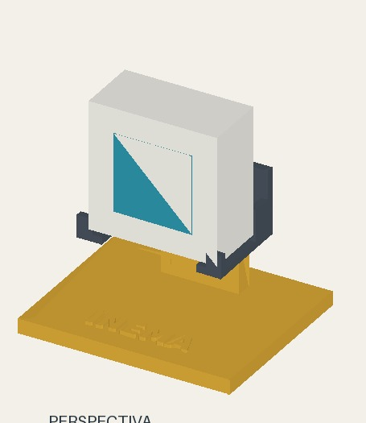

# Robô caixa fixa

**[Português](README.md) · [English](README.en.md) · [Español](README.es.md)**

## Qué es

Robô caixa fixa es un soporte impreso en 3D para quienes quieren montar un robot de mesa con menos mecánica. Usa el módulo Waveshare ESP32-S3 con pantalla de 1,54 pulgadas y conserva la carcasa y la electrónica originales. Descargas dos piezas, pruebas primero la cuna y después imprimes la base con INEMA en relieve, del mismo color. Necesitas una impresora 3D, Bambu Studio, filamento, el módulo y tornillos. El diseño se verificó en el ordenador; el encaje físico y la conversación con IA todavía no se han validado en este proyecto.

## Guía y descargas

**https://inematds.github.io/robo-caixa-fixa/guia/es/**

La guía incluye los STL, el paquete ZIP, el montaje 3D, las verificaciones y los pasos para laminar con la A1. Empieza por la cuna. Los archivos son prototipos de estudio y todavía no se han validado físicamente; no hay G-code ni un perfil 3MF validado.

## Archivos del proyecto

- [Proyecto físico (en portugués)](PROJETO-FISICO.md).
- [Definición y variantes (en portugués)](DEFINICAO.md).
- [Generador CAD](cad/gerar.py).
- [Verificación](estudo/verificacao.json).

Dos piezas y dos tornillos M3 × 16 con tuercas, por verificar en el banco de trabajo. INEMA en relieve de 1,2 mm, con letras engrosadas y retraídas 4 mm. El programa para el rostro y la IA quedan para una etapa futura.

## Vídeo del proyecto

https://www.youtube.com/watch?v=BEY94Ag9BWk
