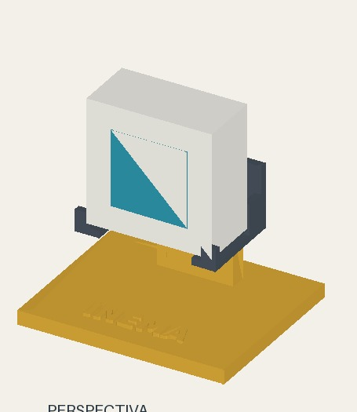

# Robô caixa fixa

**[Português](README.md) · [English](README.en.md) · [Español](README.es.md)**

## O que é

O Robô caixa fixa é um suporte impresso em 3D para quem quer montar um robô de mesa com menos mecânica. Ele usa o módulo Waveshare ESP32-S3 com tela de 1,54 polegadas, mantendo a carcaça e a eletrônica originais. Você baixa duas peças, testa primeiro o berço e depois imprime a base com INEMA em relevo, na mesma cor. Precisa de uma impressora 3D, Bambu Studio, filamento, módulo e parafusos. O desenho foi verificado no computador; o encaixe físico e a conversa por IA ainda não foram validados neste projeto.

## Guia e downloads

**https://inematds.github.io/robo-caixa-fixa/guia/**

O guia tem os STL, pacote ZIP, montagem 3D, verificações e passo a passo de fatiamento para a A1. Comece pelo berço. Os arquivos são de estudo e ainda não foram validados fisicamente; não há G-code nem perfil 3MF validado.

## Arquivos do projeto

- [Projeto físico](PROJETO-FISICO.md).
- [Definição e variantes](DEFINICAO.md).
- [Gerador CAD](cad/gerar.py).
- [Verificação](estudo/verificacao.json).

Duas peças e dois parafusos M3 × 16 com porcas, a conferir na bancada. INEMA em relevo de 1,2 mm, engrossado e recuado 4 mm. Programa do rosto e IA ficam para uma etapa futura.
